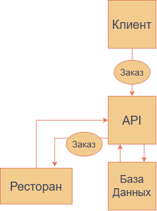

# 🍔 Avito.Kitchen (MVP)

Сервис для заказа еды из ресторанов, разработанный в рамках тестового задания для стажировки в Авито (Backend).

## 🚀 О проекте
Проект представляет собой микросервисную архитектуру, состоящую из трех контейнеров:
1. **API Service (Go):** Основной сервер, обрабатывающий запросы от клиентов и ресторанов.
2. **Restaurant Worker (Go):** Сервис-эмулятор ресторана. В фоне опрашивает API на наличие новых заказов и меняет их статусы (готовится -> в пути -> доставлено).
3. **Database (PostgreSQL):** Хранилище данных.

## 🏗 Архитектура (C4 Level 2)

Ниже представлена диаграмма контейнеров, показывающая, как сервисы взаимодействуют друг с другом.

## Архитектура


## 🗄 Схема базы данных
В проекте используются следующие таблицы:
* `restaurants`: (id, title) — список заведений.
* `menu_items`: (id, restaurant_id, name, price) — меню ресторанов.
* `orders`: (id, restaurant_id, user_id, status, total_price) — заголовки заказов.
* `order_items`: (order_id, menu_item_id, quantity) — состав заказов.

## 🛠 Стек технологий
* **Язык:** Go (net/http, pgx)
* **База данных:** PostgreSQL 16
* **Миграции:** golang-migrate (встроены в бинарник через embed)
* **Контейнеризация:** Docker, Docker Compose

## 🚦 Как запустить
1. Убедитесь, что у вас установлен Docker и Docker Compose.
2. Клонируйте репозиторий.
3. Выполните команду в корне проекта:
   ```bash
   docker-compose up --build -d
4. API будет доступно по адресу http://localhost:8080.
5. Swagger-спецификация лежит в файле swagger.yaml (или откройте её в Swagger Editor).

🧪 Тестирование API
Пример запроса на создание заказа:

Пример запроса на создание заказа:

```json
POST /orders
{
  "user_id": 1,
  "restaurant_id": 1,
  "items": [
    {
      "menu_item_id": 1,
      "quantity": 2
    }
  ]
}
```
📝 Автор
[Тимур Фаттахов] — [yoyo9000 / https://github.com/TimkaLIM]